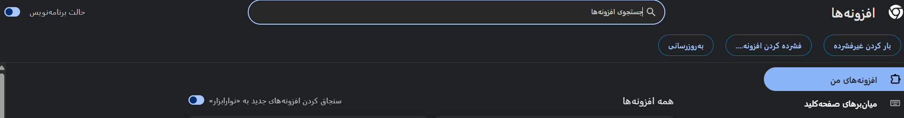
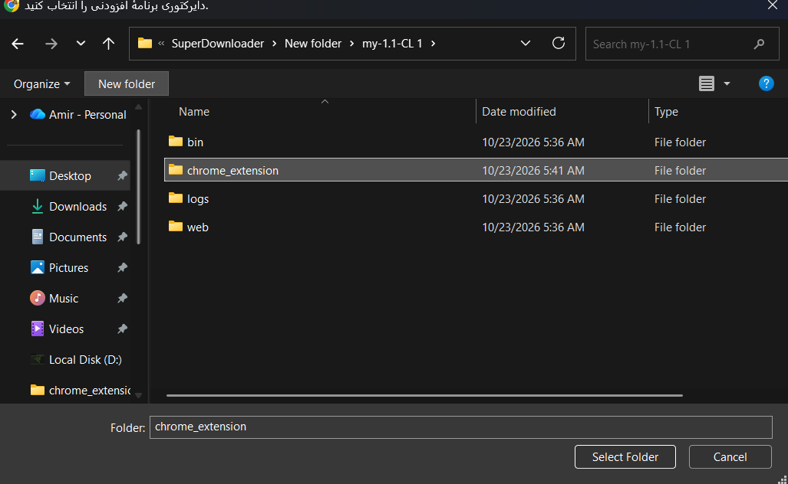
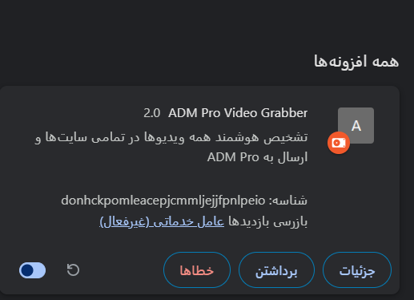
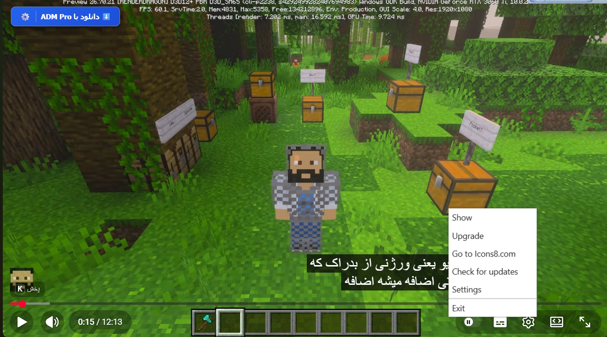
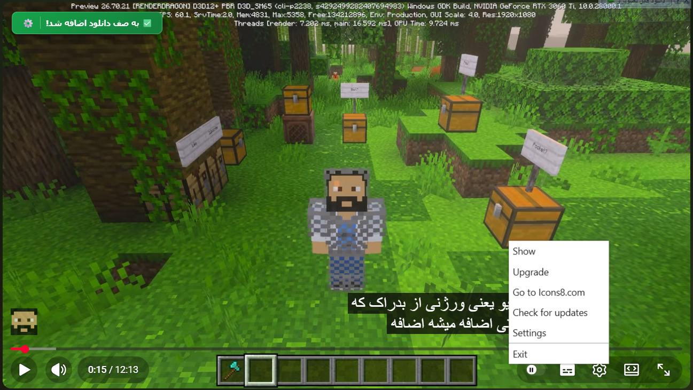

<div align="center">

# 🚀 ADM Pro Downloader (v2.2)
### Advanced, Fast & Intelligent Video, Music & Playlist Downloader
### ابزار پیشرفته، سریع و هوشمند دانلود ویدیو، موزیک و پلی‌لیست


</div>

---

## ✨ About The Project / درباره پروژه

**ADM Pro** is a modern, lightweight, and privacy-respecting open-source desktop application designed for seamless downloading of online videos, music, and playlists. It bridges a critical gap in the open-source desktop ecosystem by offering a free alternative to proprietary download managers (like IDM), combining the raw processing power of **Python (`yt-dlp` & `FFmpeg`)** with an intuitive, responsive web-based UI (**HTML/CSS/JS via Eel**) and a dedicated **Chrome Extension** for one-click stream interception.

**ADM Pro** یک نرم‌افزار دسکتاپ متن‌باز، مدرن و بهینه برای دانلود آسان انواع ویدیوها، موزیک‌ها و پلی‌لیست‌های آنلاین است که با ترکیب قدرت **Python** در پردازش‌های سنگین و رابط کاربری جذاب و روان مبتنی بر فناوری‌های وب (**HTML/CSS/JS**) توسعه یافته است. در این نسخه، با اضافه شدن اکستنشن اختصاصی کروم، دیگر نیازی به کپی و پیست کردن دستی لینک‌ها نخواهید داشت.

---

## 🏗️ System Architecture & Ecosystem Impact / معماری سیستم

Existing open-source downloaders either lack modern browser integration, struggle with dynamic media streams, or only offer command-line interfaces. **ADM Pro** solves this through a modular hybrid architecture:

* **Multi-Threaded & Stream Extraction Engine (`Python` + `yt-dlp`):** Handles complex video/audio streams, dynamic manifests, and segmented downloading with high stability over bandwidth-constrained connections.
* **Asynchronous Desktop GUI (`Eel`):** Lightweight HTML/CSS/JS frontend communicating seamlessly with the Python backend.
* **Native Browser Integration (`ADM Pro Video Grabber`):** Injects an on-hover floating action button directly onto web video players and dispatches media URLs straight to the local desktop queue via IPC/HTTP bridge.
* **Automated Dependency Provisioning:** Self-bootstrapping environment that automatically verifies and configures `yt-dlp`, `FFmpeg`, and `Deno` runtimes.

---

## 🌟 Key Features / ویژگی‌های کلیدی

* **Dedicated Chrome Extension (افزونه اختصاصی مرورگر کروم):**
  * Automatic detection of video and audio streams across websites with an on-hover floating button.
  * تشخیص خودکار ویدیوها و موزیک‌ها در تمامی وب‌سایت‌ها با دکمه شناور روی پلیر.
* **MP3 Audio Extraction (دانلود و استخراج موزیک):**
  * One-click conversion and extraction of pure audio tracks at 320kbps high fidelity via `FFmpeg`.
  * امکان دانلود مستقیم فایل‌های صوتی یا استخراج صدای ویدیو با کیفیت ۳۲۰kbps.
* **Smart Download Resume (پشتیبانی از ادامه دانلود):**
  * Interrupted downloads resume from the exact breakpoint without discarding downloaded fragments.
  * در صورت قطع اتصال اینترنت یا بستن برنامه، دانلود از همان نقطه قبلی ادامه می‌یابد و فایل‌های ناقص از ابتدا دانلود نمی‌شوند.
* **Persistent Queue & History (تاریخچه و صف دانلود دائمی):**
  * Download tasks and progress states are preserved on disk across application restarts and OS reboots.
  * ذخیره خودکار وضعیت صف دانلود در حافظه دیسک، حتی پس از خروج کامل از ویندوز.
* **Intelligent Error Categorization (مدیریت خطای پیشرفته):**
  * Meaningful classification of extraction and network failures with step-by-step resolution hints.
  * دسته‌بندی هوشمند خطاهای احتمالی و ارائه راهنمای دقیق جهت رفع آن.
* **Playlist Parser (پشتیبانی از پلی‌لیست‌ها):**
  * High-speed scanning and batch-selection for large multi-item channels and playlists.
  * تحلیل سریع و انتخاب گزینشی ویدیوها از پلی‌لیست‌های طولانی.

---

## 🧩 Chrome Extension Installation Guide / راهنمای نصب افزونه کروم

### 1. Enable Developer Mode / ۱. فعال‌سازی حالت برنامه‌نویس
Open Chrome, navigate to `chrome://extensions`, and toggle the **Developer mode** switch at the top-right corner:  
مرورگر کروم را باز کنید، به آدرس `chrome://extensions` بروید و از بالا سمت راست کلید **حالت برنامه‌نویس (Developer mode)** را روشن کنید:

<p align="center">
  
</p>

### 2. Load Extension Directory / ۲. بارگذاری پوشه افزونه
Click on **Load unpacked** and select the `chrome_extension` folder from the project directory:  
روی دکمه **بار کردن غیرفشرده (Load unpacked)** کلیک کرده و پوشه `chrome_extension` را انتخاب کنید:

<p align="center">
  
</p>

### 3. Extension Ready / ۳. آماده‌به‌کار شدن افزونه
The **ADM Pro Video Grabber** card will appear and is now ready for use:  
افزونه **ADM Pro Video Grabber** به لیست افزونه‌های مرورگر شما اضافه شده و فعال می‌شود:

<p align="center">
  
</p>

---

## 📸 How To Use & Download / نحوه استفاده و دانلود مستقیم

### 4. Hover Over Any Video / ۴. رفتن روی ویدیو در هر سایتی
Hover over any video player across the web; the floating action button will appear instantly:  
نشانگر ماوس را روی هر ویدیویی در مرورگر ببرید؛ دکمه آبی شناور نرم‌افزار بلافاصله ظاهر می‌شود:

<p align="center">
  
</p>

### 5. Send To Download Queue / ۵. ارسال به صف دانلود
Clicking the button immediately dispatches the URL to the running ADM Pro desktop app without manual copy-pasting:  
با زدن دکمه دانلود، پیام سبز رنگ تأیید ظاهر شده و لینک مستقیماً بدون نیاز به کپی کردن، وارد نرم‌افزار ADM Pro در ویندوز می‌شود:

<p align="center">
  
</p>

---

## 🛠️ Project Structure / ساختار فایل‌های پروژه

```text
📦 ADM-Pro
 ┣ 📂 bin                 # ابزارهای جانبی مورد نیاز (ffmpeg) / Precompiled tools
 ┣ 📂 chrome_extension    # سورس کد افزونه کروم / Chrome Extension files
 ┣ 📂 screenshots         # تصاویر راهنمای برنامه / Visual walkthrough assets
 ┣ 📂 web                 # رابط گرافیکی وب / UI assets (HTML/CSS/JS)
 ┣ 📜 config.json         # تنظیمات مسیر ذخیره / Core user configurations
 ┣ 📜 main.py             # هسته برنامه و سرور رابط / Python backend & bridge server
 ┣ 📜 start.bat           # اسکریپت نصب پیش‌نیازها و اجرا / Setup & launcher script
 ┣ 📜 start_silent.vbs    # اجرای در پس‌زمینه بدون ترمینال / Silent launcher
 ┗ 📜 README.md           # مستندات پروژه / Documentation

Getting Started / نحوه اجرای نرم‌افزار
Install Python: Ensure Python 3.8+ is installed on your Windows system and the "Add Python to PATH" option is checked during installation.

مطمئن شوید نسخه پایتون ۳.۸ یا بالاتر روی ویندوز نصب است و تیک Add Python to PATH فعال شده باشد.

Launch & Auto-Setup: Run start.bat. All required runtime dependencies (yt-dlp, ffmpeg, Deno) will be checked, downloaded, and provisioned automatically.

فایل start.bat را اجرا کنید؛ تمامی پکیج‌های مورد نیاز به‌صورت خودکار بررسی، دانلود و تنظیم می‌شوند.

Silent Mode (Optional): To launch the software in the background without keeping a terminal window open, execute start_silent.vbs.

جهت اجرای ساکت و مخفی کردن پنجره کنسول مشکی‌رنگ، از فایل start_silent.vbs استفاده کنید.

🗺️ Roadmap (Towards v3.0) / نقشه راه آینده
[x] Core Python + Eel desktop GUI & persistent download queue (v2.0)

[x] Dedicated Chrome Extension (ADM Pro Video Grabber) with on-hover detection (v2.2)

[x] Automated dependency bootstrapping (yt-dlp, FFmpeg, Deno)

[ ] Async Concurrency Refactoring: Optimizing multi-threaded chunk downloading and memory management

[ ] Automated Test Suite: Unit and integration tests for IPC routing and network failure recovery

[ ] Cross-Platform Packaging: Native standalone builds for Linux and macOS alongside Windows

[ ] Multi-Browser Support: Porting the extension to Firefox Add-ons and Microsoft Edge

🤝 Contributing & License / مشارکت و لایسنس
Contributions, bug reports, and feature requests are welcome! Feel free to open an issue or submit a pull request.
Distributed under the MIT License.
