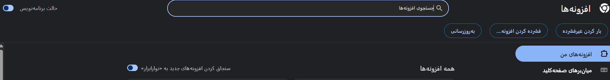
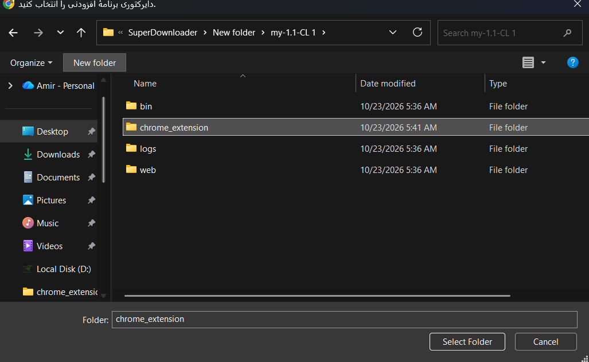
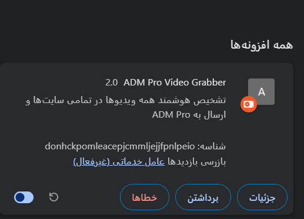
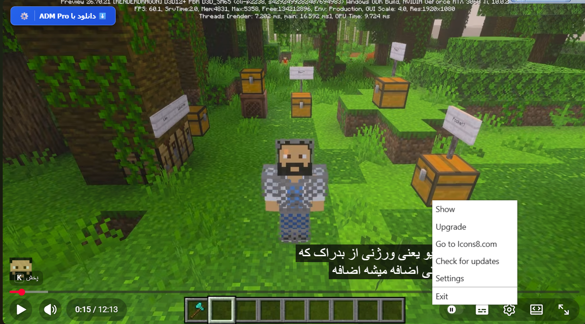
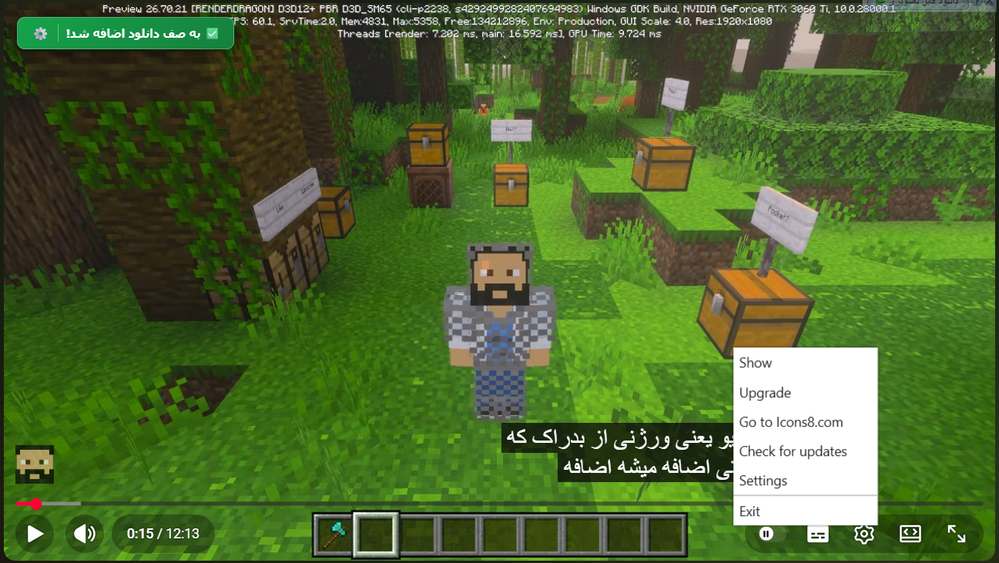

<div align="center">

# 🚀 ADM Pro Downloader (v2.2)
### ابزار پیشرفته، سریع و هوشمند دانلود ویدیو، موزیک و پلی‌لیست
### Advanced, Fast & Intelligent Video, Music & Playlist Downloader


</div>

---

## ✨ درباره پروژه / About The Project
**ADM Pro** یک نرم‌افزار دسکتاپ مدرن و بهینه برای دانلود آسان انواع ویدیوها، موزیک‌ها و پلی‌لیست‌های آنلاین است که با ترکیب قدرت **Python** در پردازش‌های سنگین و رابط کاربری جذاب و روان مبتنی بر فناوری‌های وب (**HTML/CSS/JS**) توسعه یافته است. در این نسخه، با اضافه شدن اکستنشن اختصاصی کروم، دیگر نیازی به کپی و پیست کردن دستی لینک‌ها نخواهید داشت.

**ADM Pro** is a modern and lightweight desktop application designed for seamless downloading of online videos, music, and playlists. It combines the raw processing power of **Python** with an intuitive, responsive web-based UI (**HTML/CSS/JS**). With the dedicated Chrome Extension included in this release, manual copying and pasting of URLs is no longer required.

---

## 🌟 ویژگی‌های کلیدی / Key Features
* **افزونه اختصاصی مرورگر کروم:** تشخیص خودکار ویدیوها و موزیک‌ها در تمامی وب‌سایت‌ها با دکمه شناور روی پلیر.
  * **Dedicated Chrome Extension:** Automatic detection of video and audio streams across all websites with an on-hover floating button.
* **دانلود و استخراج موزیک (MP3):** امکان دانلود مستقیم فایل‌های صوتی یا استخراج صدای ویدیو با کیفیت ۳۲۰kbps.
  * **MP3 Audio Extraction:** One-click conversion and extraction of pure audio tracks at 320 kbps high fidelity.
* **پشتیبانی از ادامه دانلود (Resume):** در صورت قطع اتصال اینترنت یا بستن برنامه، دانلود از همان نقطه قبلی ادامه می‌یابد و فایل‌های ناقص از ابتدا دانلود نمی‌شوند.
  * **Smart Download Resume:** Interrupted downloads resume from the exact breakpoint without discarding downloaded fragments.
* **تاریخچه و صف دانلود دائمی:** ذخیره خودکار وضعیت صف دانلود در حافظه دیسک، حتی پس از خروج کامل از ویندوز.
  * **Persistent Queue & History:** Download tasks and progress states are preserved across application restarts and reboots.
* **مدیریت خطای پیشرفته:** دسته‌بندی هوشمند خطاهای احتمالی و ارائه راهنمای دقیق جهت رفع آن.
  * **Intelligent Error Categorization:** Meaningful classification of extraction and network failures with step-by-step resolution hints.
* **پشتیبانی از پلی‌لیست‌ها:** تحلیل سریع و انتخاب انتخابی ویدیوها از پلی‌لیست‌های طولانی.
  * **Playlist Parser:** High-speed scanning and batch-selection for large multi-item channels and playlists.

---

## 🧩 راهنمای نصب و راه‌اندازی اکستنشن کروم / Chrome Extension Installation Guide

### ۱. فعال‌سازی حالت برنامه‌نویس / 1. Enable Developer Mode
مرورگر کروم را باز کنید، به آدرس `chrome://extensions` بروید و از بالا سمت راست کلید **حالت برنامه‌نویس (Developer mode)** را روشن کنید:  
Open Chrome, navigate to `chrome://extensions`, and toggle the **Developer mode** switch at the top-right corner:

<p align="center">
  
</p>

### ۲. بارگذاری پوشه افزونه / 2. Load Extension Directory
روی دکمه **بار کردن غیرفشرده (Load unpacked)** کلیک کرده و پوشه `chrome_extension` را انتخاب کنید:  
Click on **Load unpacked** and select the `chrome_extension` folder from the project directory:

<p align="center">
  
</p>

### ۳. آماده‌به‌کار شدن افزونه / 3. Extension Ready
افزونه **ADM Pro Video Grabber** به لیست افزونه‌های مرورگر شما اضافه شده و فعال می‌شود:  
The **ADM Pro Video Grabber** card will appear and is now ready for use:

<p align="center">
  
</p>

---

## 📸 نحوه استفاده و دانلود مستقیم / How To Use & Download

### ۴. رفتن روی ویدیو در هر سایتی / 4. Hover Over Any Video
نشانگر ماوس را روی هر ویدیویی در مرورگر ببرید؛ دکمه آبی شناور نرم‌افزار بلافاصله ظاهر می‌شود:  
Hover over any video player across the web; the floating action button will appear instantly:

<p align="center">
  
</p>

### ۵. ارسال به صف دانلود / 5. Send To Download Queue
با زدن دکمه دانلود، پیام سبز رنگ تأیید ظاهر شده و لینک مستقیماً بدون نیاز به کپی کردن، وارد نرم‌افزار ADM Pro در ویندوز می‌شود:  
Clicking the button immediately dispatches the URL to the running ADM Pro desktop app:

<p align="center">
  
</p>

---

## 🛠️ ساختار فایل‌های پروژه / Project Structure

```text
📦 ADM-Pro
 ┣ 📂 bin                 # ابزارهای جانبی مورد نیاز (ffmpeg) / Precompiled tools
 ┣ 📂 chrome_extension    # سورس کد افزونه کروم / Chrome Extension files
 ┣ 📂 screenshots         # تصاویر راهنمای برنامه / Visual walkthrough assets
 ┣ 📂 web                 # رابط گرافیکی وب / UI assets (HTML/CSS/JS)
 ┣ 📜 config.json         # تنظیمات مسیر ذخیره / Core user configurations
 ┣ 📜 main.py             # هسته برنامه و سرور رابط / Python backend & bridge server
 ┣ 📜 start.bat           # اسکریپت نصب پیش‌نیازها و اجرا / Setup & launcher script
 ┣ 📜 start_silent.vbs    # اجرای در پس‌زمینه بدون ترمینال / Silent launcher
 ┗ 📜 README.md           # مستندات پروژه / Documentation
------------------------------------------------------------------------------------------------
نحوه اجرای نرم‌افزار / Getting Started
مطمئن شوید نسخه پایتون ۳.۸ یا بالاتر روی ویندوز نصب است و تیک Add Python to PATH فعال شده باشد.

Ensure Python 3.8+ is installed on your Windows system and registered to the system PATH.

فایل start.bat را اجرا کنید؛ تمامی پکیج‌های مورد نیاز (yt-dlp ، ffmpeg ، Deno) به‌صورت خودکار بررسی، دانلود و تنظیم می‌شوند.

Run start.bat. All required runtime dependencies (yt-dlp, ffmpeg, Deno) will be checked and provisioned automatically.

جهت اجرای ساکت و مخفی کردن پنجره کنسول مشکی‌رنگ، از فایل start_silent.vbs استفاده کنید.

To launch the software without opening an active terminal prompt, execute start_silent.vbs.
